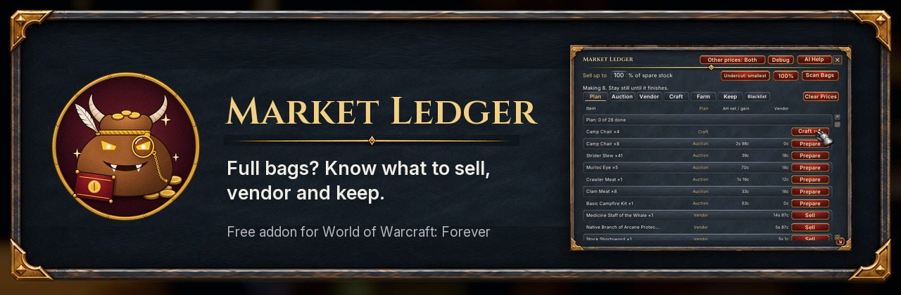
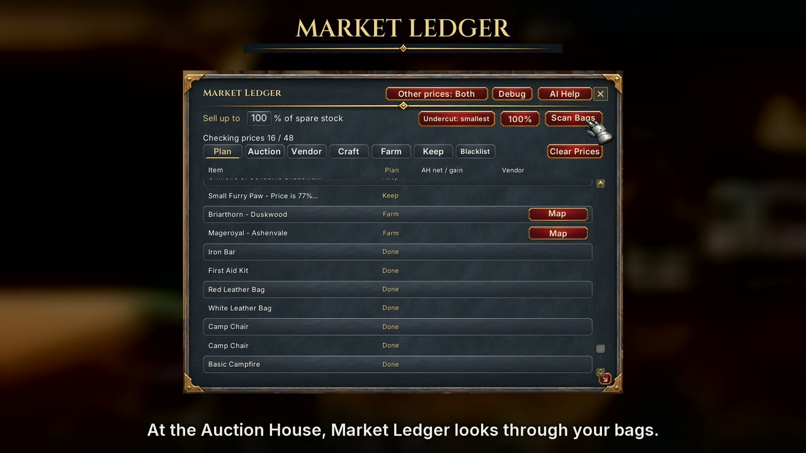
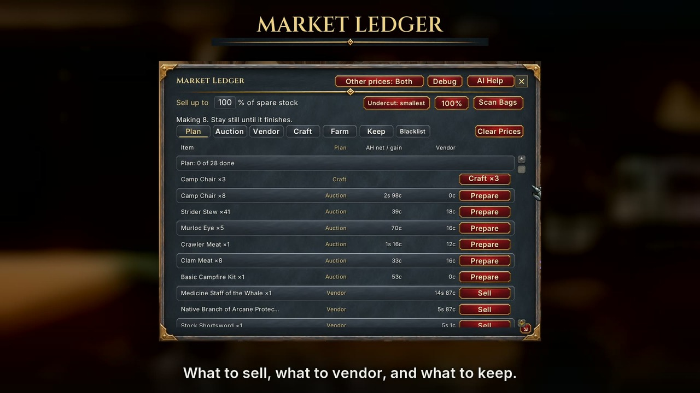
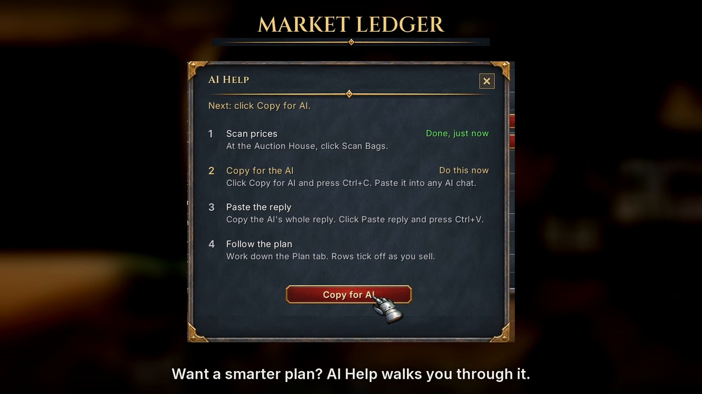
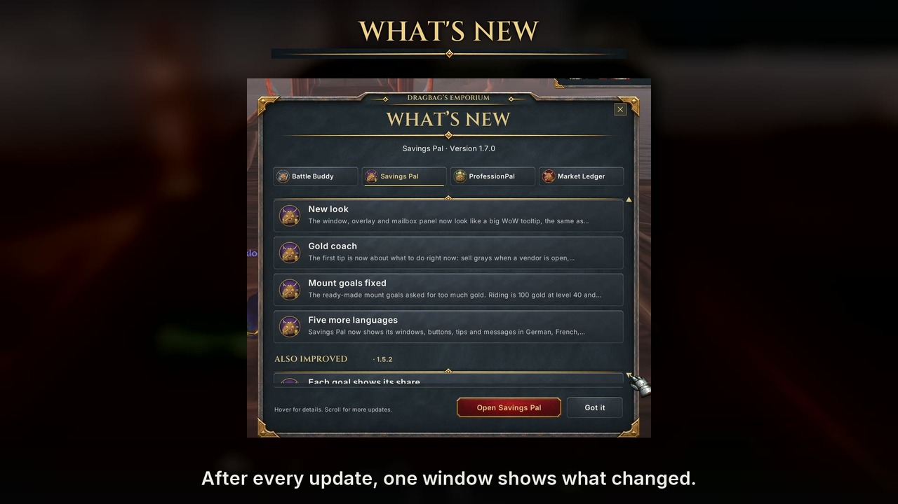

# Market Ledger

**[Get it on CurseForge](https://www.curseforge.com/wow/addons/market-ledger)** · [Download the zip](https://github.com/Yungslaya/MarketLedger/releases/latest/download/MarketLedger.zip) · [All changes](CHANGELOG.md)

**Full bags? Know your next move, then post it in two clicks.**

Market Ledger scans your bags at the Auction House and tells you what to **auction, vendor, craft, keep or farm**. When you sell, it checks the live lowest price, undercuts it, and fills in WoW's sell form for you. You always click the final Create Auction yourself.

**[Watch the video on YouTube](https://youtu.be/2W8BDpfz9jg)**

## What makes it different

- **Two-click selling at the live price.** Click **Prepare** and it checks what other players are asking right now, skips your own listings, and fills the sell form. Click again to post.
- **Undercut your way.** Smallest, 1%, 2%, 5%, or match the lowest.
- **Deposit shown.** You see the deposit before you post, and a row says Small gain when one unsold listing would cost more than you gain over vendoring.
- **Troll listings ignored.** A lone silly price far above the usual one is never used.
- **Your own rules.** Right-click an item to always keep it, always vendor it or always auction it.
- **Sell, vendor or craft?** Compares the auction price with the vendor price and with what you could craft or smelt.
- **Price on tooltips.** Point at any item to see your scan price and how old it is.
- **Price history that stays.** Your scanned days and usual prices are kept, even when the game is slow to say which realm you are on.

## How to use it

1. Open the Auction House, type **/ledger**, and click **Scan Bags**.
2. Review the **Plan**, **Auction**, **Vendor**, **Craft**, **Farm** and **Keep** tabs.
3. On the Auction tab, click **Prepare** on an item, check the sell form, then click again to post.

## AI Help: a full plan in four steps

Want a smarter plan? **AI Help** walks you through it, one step at a time.

1. Click **Scan Bags** at the Auction House.
2. Click **AI Help**, then **Copy for AI**, and press Ctrl+C.
3. Paste it into any AI chat you like and copy the reply.
4. Click **Paste reply**, press Ctrl+V, then **Save plan**. The Plan tab fills in, and rows tick off as you sell.

You pick the chat. Market Ledger itself never connects to an AI service. Check each step before you click it, because AI advice can be wrong.

## New: one look, and a What's new window

Every window now has the same stone frame, gold corners and clean text as our other addons. After an update, one window shows what changed, with a tab for each of our addons you have. Type **/ledger news** to see it again.

## Works with other addons, needs none

- **TradeSkillMaster** or **Auctionator**: when your scan has no price for an item, either one can fill it in, and the row says which one. Your own scan price is never replaced. The **Other prices** button picks Both, TSM, Auctionator or Off.
- **TradeSkillMaster**: enchanters also see a Disenchant answer when TSM values the materials above the auction and vendor price.
- **[ProfessionPal](https://www.curseforge.com/wow/addons/professionpal)**: keeps the materials your guide needs and shows prices in its Farm Planner.

Market Ledger works by itself.

## Languages

English, German, French, Spanish, Russian and Simplified Chinese. The addon switches by itself to match your game.

Only English has been tested in the game. The other languages are new and may have mistakes or parts still in English. If something looks wrong in your language, please post it in the comments.

## Good to know

Your scan shows **asking prices**, not completed sales. Unknown prices stay unknown. Rescan before relying on an old price. Comparisons assume a 5% auction cut.

- **/ledger** opens Market Ledger.
- **/ledger news** shows what changed.
- **/ledger tooltip** turns tooltip prices on or off.
- **/ledgerdebug** opens scan details when something gets stuck.

## More from Dragbag's Emporium

Four free addons with one shared look. Use one, or all four.

- **[Battle Buddy](https://www.curseforge.com/wow/addons/dbagsalerts)**: your next spell, timers and reminders, for all nine classes.
- **[ProfessionPal](https://www.curseforge.com/wow/addons/professionpal)**: one clear next step for every profession, and where to farm it.
- **[Savings Pal](https://www.curseforge.com/wow/addons/drags-hedge-fund)**: sets gold aside for your mount every time you earn.

## What's new

- **1.7.0:** New Gear and Flip tabs. One full Auction House scan shows cheap gear that beats what you wear, and cheap items to buy and resell (fast flips and slow ones bots skip), with a live price check before every purchase. AI replies now start friendly and estimate your profit. Fully restart WoW after updating.
- **1.6.1:** The report for the AI now lists your worn gear, so it can say when a bag item is an upgrade. Type `/reload` after updating.
- **1.6.0:** New look, price history that no longer starts over when the game gives a blank realm name, and a What's new window after updates. Fully restart WoW after updating.
- **1.5.4:** Pet Grimoires and class books you can still learn are kept, not sent to the vendor. Type `/reload` after updating.
- **1.5.3:** Cheap gear keeps its price, and Create Auction no longer stops with "Sell form changed". Type `/reload` after updating.
- **1.5.2:** Farm picks use your faction's zones. Type `/reload` after updating.

[All changes](CHANGELOG.md)

## Install

1. Easiest: install **Market Ledger** from [CurseForge](https://www.curseforge.com/wow/addons/market-ledger) with the CurseForge app.
2. WowUp: Get Addons, Install from URL, and paste `https://github.com/Yungslaya/MarketLedger`.
3. By hand: [download the zip](https://github.com/Yungslaya/MarketLedger/releases/latest/download/MarketLedger.zip), unzip it, and put the `MarketLedger` folder in `World of Warcraft\_forever_\Interface\AddOns`.

Fully restart WoW after installing.

## More details

Open the full guide

### Start here

1. Install Market Ledger. No other addon is required for bag scanning and selling.
2. Open the Auction House, then `/ledger`.
3. Set **Sell up to** to the percentage of spare stock you want to offer. ProfessionPal reserves are protected when installed.
4. Click **Scan Bags** and wait for **Scan complete**. This searches items relevant to your bags and available craft/farm picks, not every auction in the house.
5. Pick a tab and review the quantities before selling.

The stock limit belongs to the current plan. Selling half should not keep halving the remainder. Starting a new scan starts a new stock plan based on your current bags.

Drag the window to move it, drag its bottom-right corner to resize it, and use its percentage button to change scale. **Clear Prices** clears saved scan prices. Prices survive reloads and logouts.

### Use each tab

| Tab | What to do |
| --- | --- |
| Auction | Click **Prepare**. Review quantity and unit price in WoW's selling window, then use **Create Auction** and any confirmation WoW presents. |
| Vendor | Visit a merchant and click **Sell** for the row. Soulbound bag items with a sell value can appear here. |
| Craft | With ProfessionPal, review the recipe and amount. **Craft it** opens the profession and selects the recipe; another click crafts when materials and the station are available. Missing-material guidance shows what you still need. |
| Keep | Read why an item is reserved, protected or missing a reliable price. |
| Farm | With ProfessionPal, choose a gatherable item and click **Map** for its suggested zone. |
| Blacklist | Right-click a bag-item row to exclude it from selling recommendations. Use this tab to restore it. |
| Plan | Follow imported advice in order. Completed sale/craft quantities are tracked as your bags change. |

Active quest items, blacklisted items and known profession reserves are protected. Blacklist gear or supplies you personally want to keep. Each sale or craft needs your click.

### Use ChatGPT, Claude or another AI chat

No API key is required for this route.

1. Finish **Scan Bags**.
2. Open **AI Help**, click **Copy for AI**, and press Ctrl+C.
3. Paste into your preferred chat. The report explains stock limits, price information and the required plan format.
4. Copy the returned PLAN code block. Click **Paste reply** in Market Ledger, paste it, then **Save plan**.
5. Open **Plan** and check each proposed action before clicking it.

You can also paste the whole response. Names must match the report, quantities must stay within spare stock, and Auction prices are copper **per item**. The importer checks supported steps against the report; advice can still be wrong. After a rescan or major bag changes, request a fresh plan.

The report includes item names, counts, recipes and prices. You choose which chat receives it. The addon itself does not connect to an AI service.

### Add TradeSkillMaster for price context

1. Install the WoW: Forever-compatible [TradeSkillMaster addons](https://www.tradeskillmaster.com/) and set up their desktop app for your realm using TSM's instructions.
2. Let its data update, then start WoW with TSM enabled.
3. Run a Market Ledger scan. Hover an item or use **Copy for AI** to see available TSM data. No separate linking step is needed.

Your scan shows **asking prices**, not completed sales. The usual-price trend comes from earlier scans. TSM adds regional sale-price/rate/volume context when available; some price fields can fall back to market averages. These references do not promise your next sale.

Vendor comparisons can include TSM's cached realm minimum buyout for the item's full link. Its age is unknown here. It never silently replaces an unknown scan price. Comparisons assume a 5% auction cut and exclude deposits: review the actual selling window, especially for tiny gains.

**AH busy?** Stop another active auction scan, or click **WoW UI** in TSM, then return to Market Ledger. A paused scan resumes with **Scan Bags**. TSM can stay loaded, preserving its price context. Market Ledger does not disable TSM or automatically cancel its work.

### Farm routes with ProfessionPal and Shortest Path Forever

1. Install [ProfessionPal](https://github.com/Yungslaya/ProfessionPal). Learn Mining, Herbalism or Skinning for relevant Farm picks.
2. Optionally install [Shortest Path Forever](https://github.com/cjber/shortest-path-forever). Fully restart WoW after adding addons.
3. Open **Farm**, or a Farm step in **Plan**, and click **Map**.
4. ProfessionPal opens the zone and gathering spots. With Shortest Path Forever, it requests a road/travel route through that addon's public API. Otherwise it uses a normal map pin.
5. Follow it yourself. **Next** skips a spot; **Clear** on the map or **Stop route** in ProfessionPal ends the guide.

Spots show possible spawns, not currently available nodes. Consider demand and travel time as well as asking price. Nothing moves or gathers for you.

### Troubleshooting

- Stop other auction scans before resuming a paused scan.
- Click **Debug**, copy the report, and describe what you clicked and what happened. It contains scan/selling events, not chat history.
- Unknown prices stay unknown. Rescan rather than treating them as zero.
- For crafting, check materials, selected profession and the required anvil, fire or other station.
- TSM is optional. Craft/Farm integration needs ProfessionPal; road routing also needs Shortest Path Forever.

### Credits

- Price and sales numbers from [TradeSkillMaster](https://www.tradeskillmaster.com/) when you have it (optional).
- Road routes by [Shortest Path Forever](https://github.com/cjber/shortest-path-forever) by cjber (optional).
- Gathering spots from the [Wowhead WoW: Forever database](https://www.wowhead.com/forever), through ProfessionPal.
- Best farming zones from Wowhead's farming guides and Icy Veins' WoW: Forever leveling guides, through ProfessionPal.

None of their code is included.

